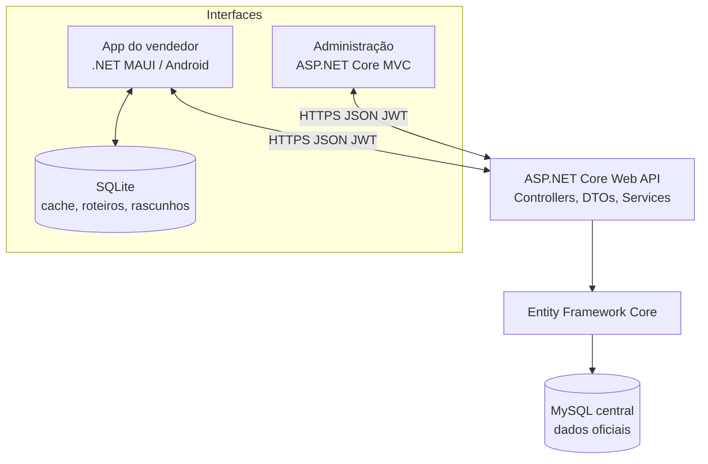

# Distribuidora de Panificação — Sistema B2B de Gestão e Força de Vendas

> **Projeto acadêmico | Documento mestre de requisitos e arquitetura**  
> **Versão:** 1.0 — **21/10/2026**  
> **Situação:** em desenvolvimento — este documento diferencia funcionalidades implementadas de funcionalidades planejadas.  
> **Plataformas:** aplicativo Android para vendedores, painel administrativo Web e API REST.

**Documentação detalhada:** [Requisitos](docs/01-REQUISITOS.md) · [Arquitetura e padrões](docs/02-ARQUITETURA-PADROES.md) · [Modelo de dados](docs/03-MODELAGEM-DADOS.md) · [Regras de negócio](docs/04-REGRAS-NEGOCIO.md) · [API REST](docs/05-API-REST.md) · [Testes](docs/06-TESTES.md) · [Ambiente](docs/07-AMBIENTE.md) · [Plano e decisões](docs/08-PLANO-DECISOES.md) · [Uso de IA e ética](docs/09-USO-IA-ETICA.md).

## 1. Visão geral

O projeto pretende digitalizar as operações de uma **distribuidora de produtos para panificação**, com foco **B2B** (distribuidora para padarias, confeitarias e outros estabelecimentos). O **vendedor externo** percorre uma carteira e um roteiro de visitas, visualiza compras anteriores, valores e débitos autorizados, registra pedidos e os transmite à distribuidora. O **administrador** recebe os pedidos, gerencia clientes e produtos, define **cortes** por insuficiência de estoque, registra vendas e acompanha **contas a receber**.

A distribuidora trabalha com **produtos perecíveis** — como fermento, misturas e margarina —, o que motiva controle de lotes e validade. As anotações da aula de 19/10/2026 mencionam envio dos pedidos em horários como **12h e 19h**, corte de estoque, condição de pagamento parcelado, multa, juros e descontos. Este README registra tanto o levantamento de aula quanto escolhas **propostas** de engenharia, distinguindo-as quando ainda não foram validadas pelo professor.

### Objetivo geral

Desenvolver uma solução integrada de vendas externas e gestão administrativa, centralizando pedidos, estoque, corte, faturamento acadêmico e recebíveis na API e no MySQL.

### Objetivos específicos

1. Gerir vendedores, carteira de clientes, cidades, estados, produtos e grupos.
2. Permitir roteiro ordenado de visitas e cadastro de clientes durante atendimento.
3. Consultar histórico de compras, última quantidade, preço e débitos do cliente.
4. Criar pedidos pelo Android, com rascunhos offline e envio idempotente.
5. Receber pedidos por janelas operacionais e realizar cortes documentados.
6. Impedir atendimento acima do estoque válido e preservar quantidades originais solicitadas.
7. Registrar vendas apenas das quantidades efetivamente atendidas.
8. Configurar condições de pagamento e gerar parcelas de contas a receber.
9. Proteger operações por autenticação, papéis e escopo de carteira.
10. Manter testes unitários, integração MySQL, documentação e histórico Git.

## 2. Atores e permissões

| Perfil | Responsabilidades |
|---|---|
| **Vendedor** | Consultar sua própria carteira, roteiro, compras e débitos autorizados; cadastrar clientes conforme política; registrar, enviar e acompanhar pedidos. |
| **Administrador** | Cadastros, organização de carteiras, estoque, análise e corte de pedidos, vendas, condições de pagamento e relatórios. |
| **Financeiro** (evolução) | Consultar contas a receber e registrar baixas de pagamentos. |
| **Sistema/API** | Validar regras, autorizar ações, calcular valores, preservar transações, auditoria e idempotência. |

## 3. Escopo: MVP versus evolução

**MVP proposto:** autenticação e autorização; cadastro de vendedores, clientes, cidades/estados, grupos e produtos; controle de lotes/validade; carteira e roteiro manual; consulta de última compra/débitos; pedidos e reenvio seguro; painel de processamento; **corte manual**; venda originada do corte; condições e parcelas; contas a receber cadastrais; aplicativo Android com SQLite para cache e rascunhos; testes.

**Evolução:** algoritmo de corte proporcional, otimização geográfica do roteiro, notificações push, relatórios avançados, cálculo complexo de antecipação/atraso, emissão de boleto bancário e Pix integrados, integração fiscal, sincronização automática em segundo plano e rastreamento de entrega.

**Importante:** cadastrar a forma de pagamento “Pix” ou “boleto” **não** significa processar Pix nem emitir boleto bancário real. O projeto acadêmico não presume integração com instituições financeiras.

## 4. Softwares, ferramentas e tecnologias

| Camada | Tecnologia | Função / situação |
|---|---|---|
| Ambiente | Windows, PowerShell e Visual Studio Code | Desenvolvimento e execução local. |
| Linguagem | C# e **.NET 10** | Base do projeto já criada. |
| Backend | ASP.NET Core **Web API** | REST, JWT, autorização, serviços, transações. |
| Site | ASP.NET Core **MVC** | Painel administrativo, consumindo API por HTTP. |
| Aplicativo | **.NET MAUI** Android | Visitas e pedidos externos; ainda a criar. |
| Persistência central | **MySQL 8.x** + MySQL Workbench | Fonte oficial de clientes, preços, pedidos, estoque, vendas e recebíveis; a configurar. |
| ORM | **EF Core 9.x + Pomelo MySQL 9.x** | Proposta de versão; Pomelo 9 requer EF Core 9 e suporta .NET 8+. |
| Persistência móvel | **SQLite** | Cache, roteiros e rascunhos; não define estoque oficial. |
| Autenticação | **JWT** na API | Papéis Admin/Vendedor + autorização por propriedade de recurso. |
| Testes | **xUnit** + testes de integração MySQL | Projeto xUnit base criado; cenários de negócio a implementar. |
| API / diagnóstico | OpenAPI, Swagger UI opcional, PowerShell | Testes de endpoints e contratos. |
| Versionamento | Git + GitHub | Controle de mudanças, revisão e entrega acadêmica. |
| Operação opcional | Docker Desktop | MySQL em contêiner, caso adotado pelo desenvolvedor. |

**Compatibilidade:** consultar [Pomelo (README oficial)](https://github.com/PomeloFoundation/Pomelo.EntityFrameworkCore.MySql#compatibility). Não misturar automaticamente EF Core 9 com ferramentas e pacotes EF Core 10. Versões exatas de pacotes, banco e Android serão registradas quando instaladas.

## 5. Estado REAL do desenvolvimento — 21/10/2026

| Artefato | Estado | Validação |
|---|---|---|
| `DistribuidoraPanificacao.sln` | **Criado** | Solução .NET 10. |
| `Distribuidora.API` | **Criado** | `dotnet build` e `GET /api/status` = **HTTP 200**. |
| `Distribuidora.Web` | **Projeto-base criado** | Painel funcional ainda não implementado. |
| `Distribuidora.Tests` | **Projeto-base criado** | Testes de regras do domínio ainda não implementados. |
| `Models/Vendedor.cs` | **Criado e compilado** | Classe inicial. |
| `Models/Cliente.cs` | **Criado e compilado** | Classe inicial. |
| `Models/Produto.cs` | **Criado e compilado** | Classe inicial. |
| `Models/StatusPedido.cs` | **Criado e compilado** | Enum inicial. |
| `Models/Pedido.cs` | **Criado e compilado** | Classe inicial. |
| `Models/ItemPedido.cs` | **Criado e compilado** | Classe inicial. |
| `DbContext`, MySQL, migrations | **Planejado** | Não foram criados para este novo projeto. |
| Web administrativa funcional, login, cortes, vendas, financeiro | **Planejados** | Não implementados. |
| `Distribuidora.Mobile` e SQLite | **Planejados** | Não implementados. |

> Não confundir os testes e os recursos concluídos do **projeto anterior LojaLimpeza** com o estado desta nova distribuidora. São projetos independentes.

## 6. Arquitetura da solução



**Responsabilidades:** o Android gerencia interface e rascunhos; o MVC mostra a operação administrativa; a **API concentra toda regra crítica** (preços, autorização, corte, concorrência, totalização, parcelas); MySQL é fonte oficial; SQLite guarda dados locais sujeitos a revalidação. Nem MVC nem MAUI conectam diretamente ao MySQL. Detalhes em [02-ARQUITETURA-PADROES](docs/02-ARQUITETURA-PADROES.md).

## 7. Requisitos funcionais (RF) — resumo

| ID | Requisito | Prioridade |
|---|---|---|
| RF01 | Login e perfis Admin/Vendedor. | MVP |
| RF02 | CRUD de vendedores e carteira de clientes. | MVP |
| RF03 | CRUD de clientes, cidade, estado e contatos. | MVP |
| RF04 | Grupos, produtos, unidades, preços e lotes de estoque/validade. | MVP |
| RF05 | Roteiro de visitas ordenado e cadastro de cliente em campo. | MVP |
| RF06 | Histórico de última compra e valores devidos. | MVP |
| RF07 | Registro e envio idempotente de pedidos via vendedor. | MVP |
| RF08 | Rascunho offline Android e sincronização sob comando/condição validada. | MVP móvel |
| RF09 | Consolidação de pedidos em janelas operacionais (12h/19h como referência). | MVP, regra a validar |
| RF10 | Recepção, análise e **corte manual** por disponibilidade. | MVP |
| RF11 | Preservar quantidades solicitadas e atendidas; atualizar estoque com segurança. | MVP |
| RF12 | Gerar venda com base no efetivamente atendido. | MVP |
| RF13 | Cadastrar condições/parcelas e formas de pagamento. | MVP |
| RF14 | Gerar e consultar contas a receber. | MVP |
| RF15 | Consultar status e histórico de pedidos. | MVP |
| RF16 | Logs de auditoria de operações críticas. | MVP |
| RF17 | Sugestão proporcional de corte. | Evolução |
| RF18 | Encargos de pagamento avançados (após validar fórmula). | Evolução |

[Catálogo completo e critérios de aceitação](docs/01-REQUISITOS.md).

## 8. Requisitos não funcionais (RNF)

**RNF01** API segura por HTTPS fora de desenvolvimento. **RNF02** papéis e acesso por vínculo vendedor/cliente. **RNF03** transações e proteção contra saldo negativo e duplicidades. **RNF04** `decimal`/`DECIMAL` para dinheiro. **RNF05** instantes armazenados em UTC; janelas interpretadas no fuso definido para a distribuidora. **RNF06** logs sem credenciais; segredos fora do Git. **RNF07** integração e testes em banco exclusivo. **RNF08** aplicativo tolerante a falta de conexão sem gerar pedidos duplicados. **RNF09** interface acessível e mensagens claras. **RNF10** metas quantitativas de desempenho e Android mínimo **a definir**.

## 9. Regras de negócio fundamentais (RN)

- **RN01:** vendedor só acessa clientes da própria carteira; Admin pode gerir vínculos.
- **RN02:** pedido registra **quantidade solicitada** e preço acordado; criação não garante disponibilidade futura.
- **RN03:** a distribuidora decide **quantidade atendida** com `0 ≤ atendida ≤ solicitada`.
- **RN04:** soma atendida do produto não pode exceder estoque elegível, considerando lotes válidos e operações concorrentes.
- **RN05:** corte conserva histórico original da solicitação e motivo.
- **RN06:** baixa de estoque e fechamento do corte são transacionais e idempotentes; ponto exato da baixa será confirmado com professor.
- **RN07:** produtos vencidos ou bloqueados não devem ser usados; FEFO (*First Expire, First Out*) é política proposta.
- **RN08:** reenviar pedido offline com a mesma chave não cria duplicata.
- **RN09:** **venda** considera somente itens efetivamente atendidos; pedido não é sinônimo de venda.
- **RN10:** **conta a receber** deriva da venda e da condição acordada; soma das parcelas deve fechar o valor da venda.
- **RN11:** multas, juros e descontos são regras parametrizáveis, **não** presumidas com base apenas nos exemplos da aula.
- **RN12:** corte, estoque, venda e financeiro geram auditoria.

[Regras aprofundadas e exceções](docs/04-REGRAS-NEGOCIO.md).

## 10. Exemplo principal da aula — corte de pedidos

Estoque elegível de **Produto XYZ: 15 unidades**. Três clientes solicitam A=5, B=8 e C=9, totalizando **22 unidades**. Faltam 7.

| Cliente | Solicitada | Atendida (exemplo das anotações) | Cortada |
|---|---:|---:|---:|
| A | 5 | 4 | 1 |
| B | 8 | 5 | 3 |
| C | 9 | 6 | 3 |
| **Total** | **22** | **15** | **7** |

**A distribuição 4/5/6 é ilustrativa**, e não pressupõe que o professor exigiu uma fórmula proporcional. O MVP proporá **corte manual**, validando limites; algoritmo sugerido de corte proporcional pode ser implementado em evolução.

## 11. Exemplo de contas a receber

Venda de **R$ 235,00** em **19/10/2026**, condição 7/14 dias, 50%/50%:

| Parcela | Vencimento | Forma cadastrada | Valor |
|---|---|---|---:|
| 1 | 26/10/2026 | Boleto | R$ 117,50 |
| 2 | 02/11/2026 | Boleto | R$ 117,50 |

A aula também apresentou condição 7/14/21 dias com 33,33% + 33,33% + 33,34%, com Pix/boleto como formas de pagamento, e exemplos de **multa de 5%, juros de 2% ao dia e desconto de 1% ao dia**. Essas taxas são apenas anotações para validação com professor e **não serão aplicadas automaticamente sem definir base e fórmula**.

## 12. Modelo de dados e status do pedido

**Classes já existentes:** `Vendedor`, `Cliente`, `Produto`, `Pedido`, `ItemPedido`, `StatusPedido`.

**Status inicial já criado:** `Pendente=1`, `EmAnalise=2`, `Atendido=3`, `AtendidoParcialmente=4`, `Cancelado=5`.

**Modelo MySQL previsto:** Usuários, Vendedores, Clientes, Estados, Cidades, GruposProduto, Produtos, LotesEstoque, MovimentacoesEstoque, Roteiros/Visitas, Pedidos, ItensPedido, LotesProcessamento/Alocacoes, Vendas, ItensVenda, CondicoesPagamento, ParcelasCondicao, FormasPagamento, ContasReceber, Recebimentos e Auditoria. Ainda não existem tabelas físicas neste novo projeto.

**SQLite previsto:** cache de clientes/produtos/roteiros, rascunhos de pedidos e fila de envio. [Diagrama ER e chaves](docs/03-MODELAGEM-DADOS.md).

## 13. API REST — contrato inicial

| Método / rota | Acesso | Estado |
|---|---|---|
| `GET /api/status` | Público | **Implementado: HTTP 200** |
| `POST /api/auth/login` | Público | Planejado |
| `GET /api/vendedores/me/clientes` | Vendedor | Planejado |
| `GET /api/vendedores/me/roteiro` | Vendedor | Planejado |
| `GET /api/produtos` | Admin/Vendedor | Planejado |
| `POST /api/pedidos` | Vendedor | Planejado |
| `GET /api/pedidos/me` | Vendedor | Planejado |
| `GET /api/admin/pedidos` | Admin | Planejado |
| `PUT /api/admin/pedidos/{id}/corte` | Admin | Planejado |
| `POST /api/admin/processamentos/{id}/finalizar` | Admin | Planejado |
| `GET /api/admin/contas-receber` | Admin | Planejado |

As rotas acima **não implementadas** são rascunhos de contrato; revisar antes do desenvolvimento. [Contrato detalhado e JSON](docs/05-API-REST.md).

## 14. Padrões adotados

- **MVC** na camada web; **MVVM** planejado para o MAUI.
- **API REST + DTOs** para não expor entidades EF diretamente.
- **Dependency Injection + Service Layer** (`PedidoService`, `CorteService`, `FinanceiroService`); controllers finos.
- **DbContext** como unidade de trabalho; repositório adicional somente se necessário, sem abstração genérica redundante.
- **Transações e validação otimista/atualização condicional** em saldos, alocações e vendas.
- **Chave de idempotência + UNIQUE** para reenvio de pedidos.
- **C# PascalCase** para tipos/propriedades, `camelCase` para parâmetros, `_camelCase` para campos, `Async` para métodos assíncronos.
- **Git**: commits pequenos com `feat:`, `fix:`, `test:`, `docs:`; revisão antes do push; `.gitignore` e variáveis secretas.
- **Testes xUnit** com Arrange–Act–Assert, segregação MySQL de teste e casos de concorrência.

[Convenções e padrões detalhados](docs/02-ARQUITETURA-PADROES.md).

## 15. Estrutura atual e evolução

```text
DistribuidoraPanificacao/
├── DistribuidoraPanificacao.sln          # Criado
├── Distribuidora.API/                 # Criado
│   ├── Controllers/StatusController.cs  # Criado
│   ├── Models/                        # 6 classes/tipos criados
│   ├── Data/                          # Futuro DbContext e mapeamentos
│   ├── Dtos/                          # Futuro
│   └── Services/                      # Futuro
├── Distribuidora.Web/                 # Projeto MVC criado
├── Distribuidora.Tests/               # Projeto xUnit criado
├── Distribuidora.Mobile/              # Ainda não criado
├── docs/                              # Esta documentação
└── README.md
```

## 16. Plano de desenvolvimento

| Etapa | Entrega | Estado |
|---|---|---|
| 01 | Solução, API de status, MVC, xUnit | **Concluída e validada** |
| 02 | Seis classes iniciais de modelo | **Concluída e compilada** |
| 03 | MySQL, `DbContext`, Entity Framework, primeira migration | Próxima etapa |
| 04 | Cadastros e autorização | Planejada |
| 05 | Estoque por lote e validade | Planejada |
| 06 | Pedidos, histórico e idempotência | Planejada |
| 07 | Corte manual e processamento em janelas | Planejada |
| 08 | Vendas, condições e contas a receber | Planejada |
| 09 | Painel MVC administrativo | Planejada |
| 10 | MAUI, SQLite, roteiro e sincronização | Planejada |
| 11 | Testes integrados, segurança, apresentação | Planejada |

O cronograma em semanas ainda depende da data de entrega da disciplina. [Plano, decisões e riscos](docs/08-PLANO-DECISOES.md).

## 17. Riscos principais

Concorrência no estoque, pedidos duplicados por falhas de rede, validade de lotes, cálculo financeiro ambíguo, acesso do vendedor a carteiras alheias, descompasso de versões EF/Pomelo, vazamento de credenciais no Git e crescimento excessivo do MVP. Responderemos com transações, testes, autorização de escopo, critérios de aceite, revisão de dependências e decisões registradas.

## 18. Fontes e próximos passos

**Origem do levantamento:** quatro imagens de anotações “Distribuidor de produtos de panificação” e o arquivo `Resumo Aula.txt`, da aula de 19/10/2026. Trechos atribuídos à aula incluem B2B, perecíveis, roteiro, histórico/devedores, horários 12h/19h, corte, cadastros e condições financeiras. **Propostas de engenharia** — controle por lote/FEFO, autenticação JWT, arquitetura por services, idempotência, SQLite offline e divisão em MVP/evoluções — precisam de confirmação no projeto acadêmico.

**Próximo passo prático:** construir o `DistribuidoraDbContext`, revisar relacionamentos, configurar novo banco MySQL **exclusivo** `DistribuidoraDb` e gerar a migration. Não usar bancos do projeto LojaLimpeza.

**Legenda:** RF = Requisito Funcional · RNF = Não Funcional · RN = Regra de Negócio · CT = Caso de Teste · D = Decisão. **Documentação viva:** só marcar como concluído após código, execução e teste demonstrável.

## 19. Atualização do andamento — 22/10/2026

> **Registro de acompanhamento:** estado informado pelo desenvolvedor. O repositório contém atualmente a documentação; os arquivos de código-fonte e migrations devem ser publicados a partir do computador de desenvolvimento.

- **Aulas 1–3:** solução inicial, API, entidades, EF Core, MySQL Docker e migrations — relatadas como concluídas.
- **Aula 4:** CRUD de vendedores — testado por POST/GET/PUT/PATCH.
- **Aula 5:** cadastro de clientes associado a vendedor — testado na API e no MySQL.
- **Aula 6:** roteiro inicial, reordenação e script PowerShell — funcionamento confirmado.
- **Aula 7:** grupos, produtos, lotes e estoque — **testes locais aprovados**: saldo 20/20/0; conflito de lote duplicado (409), quantidade zero (400) e grupo com produto ativo (409). [Registro](docs/07-CATALOGO-LOTES.md).
- **Aula 8:** movimentações por lote (entrada/saída), transação, histórico e idempotência — **testes locais aprovados**: saídas, entradas, saldos 22/22/0 e proteções 400/409. [Evidências](docs/08-MOVIMENTACOES-ESTOQUE.md).
- **Aula 9.1:** pedidos pendentes, validação de carteira, preços por item e idempotência por UUID — **Build, migration e testes locais aprovados**. [Evidências](docs/09-PEDIDOS-PENDENTES.md).
- **Aula 9.2:** corte manual, consumo FEFO, alocações por lote e transação atômica — **Build, migration e testes locais aprovados**. [Registro](docs/09-2-CORTE-MANUAL-PEDIDOS.md).
- **Aula 9.3:** prévia consultiva das janelas de 12h e 19h — **erro de arquivo bloqueado resolvido e build reportado como funcionando; logs de xUnit e PowerShell não apresentados**. [Planejamento](docs/09-3-JANELAS-DE-CORTE.md).
- **Aula 9.4:** fechamento manual da janela de pedidos — **script corrigido e execução confirmada pelo desenvolvedor**; não movimenta estoque. [Regras](docs/09-4-FECHAMENTO-JANELAS.md).
- **Aula 9.5:** processamento transacional de janela — **processamento real do lote 1 validado localmente**: pedido 1, produto 4, 8 solicitadas, 3 atendidas, status parcial e valor R$ 37,50; retorno confirma `processado=True`. **Consulta de rastreabilidade no Workbench confirmada pelo desenvolvedor; testes de concorrência permanecem pendentes.** [Evidências e próximos passos](docs/09-5-PROCESSAMENTO-LOTE.md).

Não expor os Controllers sem autorização JWT e não versionar senhas, `.env` ou User Secrets.


## 20. Roteiro de conclusão do MVP — 26/10/2026

O restante do MVP foi dividido em **dez macroetapas didáticas (Aulas 10–19)**, priorizando JWT, vendas, financeiro, MVC, MAUI + SQLite offline, testes e entrega. Algumas poderão exigir subetapas adicionais; não há prazo fixado. Veja [o planejamento detalhado](docs/10-ROADMAP-FINALIZACAO.md). Integrações bancárias e fiscais reais e otimizações avançadas estão fora do MVP proposto.
